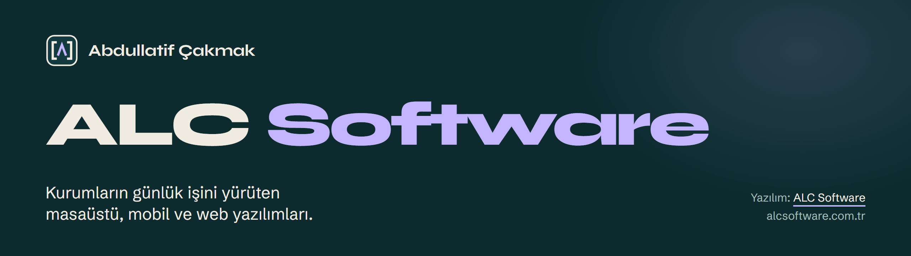

### Merhaba, ben Abdullatif.

Gümüşhane Üniversitesi Yazılım Mühendisliği mezunuyum. **ALC Software** adıyla kurumlara masaüstü, mobil ve web yazılımlarını sunucusuyla birlikte baştan sona geliştiriyorum.

Önce işi anlıyorum, kararları yazıya döküyorum ve her aşamanın sonunda denenebilir bir sürüm teslim ediyorum.

### Öne çıkan işler

| Proje | Ne yapıyor | Teknolojiler |
| --- | --- | --- |
| **[Paket Bilgisi](https://paketbilgisi.com)**   🏆 ProjeVadi Proje Pazarı, 76 proje arasında birinci | Paketli gıdaların kalorisini, içeriğini ve katkı maddelerini tek aramada gösteren, daha hafif alternatifi öneren web platformu (ekip projesi) | Laravel, PHP, JavaScript |
| **BAM Akademi** | Bir dershane için canlı ders, ödev, mesajlaşma ve yönetimi tek çatıda toplayan platform (Windows, Android, web) | Flutter, NestJS, PostgreSQL, LiveKit |
| **Cari Takip**   Geliştiriliyor | Esnaf için barkodlu kasa, stok, veresiye ve cari hesap takibi | Laravel, MySQL, Tailwind CSS |
| **[TaksiBurada](https://github.com/abdullatifcakmak/TaksiBurada)** | Haritadan konum seçip taksi çağırma, taksi listesi ve profil yönetimi (ekip projesi) | React Native, Expo, Firebase |

Bütün işler: **[alcsoftware.com.tr/projeler](https://alcsoftware.com.tr/projeler)**

### Kullandığım araçlar

  &nbsp;
  &nbsp;
  &nbsp;
  &nbsp;
  &nbsp;
  &nbsp;
  &nbsp;
  &nbsp;
  &nbsp;
  &nbsp;
  &nbsp;
  

### İletişim

Aklında bir proje varsa yaz, en geç bir iş günü içinde dönerim.

